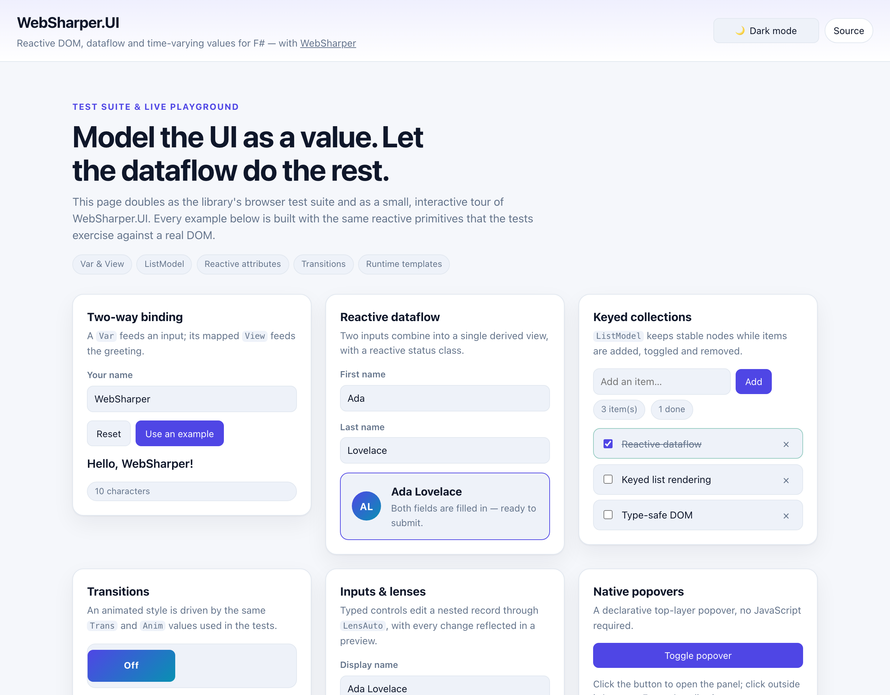

# WebSharper.UI

[](https://gitter.im/intellifactory/websharper.ui.next?utm_source=badge&utm_medium=badge&utm_campaign=pr-badge&utm_content=badge)

WebSharper.UI is a UI library featuring a dataflow layer for expressing
time-varying values. It integrates with DOM and makes it
simple to construct animated UI in the browser.



## Test suite and playground

The `WebSharper.UI.Tests` project is both the F# browser test suite and a small
interactive playground. The playground walks through two-way binding, derived
views, keyed `ListModel` rendering, transitions, lenses and input controls,
native popovers, and runtime templates. Below it, QUnit runs the full F#
suite against a real DOM.

The page is light-themed by default and has a dark mode toggle that persists
the choice in `localStorage`.

To run it:

```sh
dotnet run --project WebSharper.UI.Tests -c Release
```

Then open the URL printed by ASP.NET Core (or the one from
`WebSharper.UI.Tests/Properties/launchSettings.json`).

* [Examples](https://websharper-samples.github.io/ui/)
* [Example Site Repository](https://github.com/websharper-samples/ui)
* [Tutorial and documentation](https://developers.websharper.com/docs/v4.x/fs/ui)
* [Guide for contributing to this project](https://github.com/dotnet-websharper/ui/blob/master/CONTRIBUTING.md)

> Note: WebSharper.UI is the new name of WebSharper.UI.Next. If you have been using the latter, we recommend that you upgrade to UI.

## Acknowledgements

This design is a result of vibrant discussion and experimentation.  The list of people who have contributed
time, ideas and code includes:

* Simon Fowler
* Anton Tayanovskyy
* Andras Janko
* Loic Denuziere
* Adam Granicz
* Vesa Karvonen
